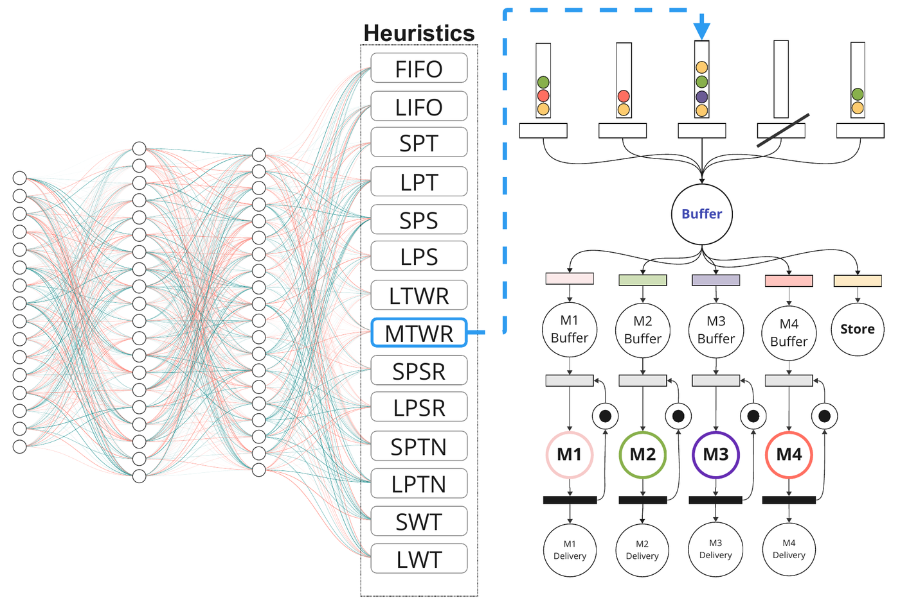

# PetriRL Hyper-Heuristic

A deep reinforcement learning hyper-heuristic for the Job Shop Scheduling Problem, built on a colored timed Petri net.
The agent learns which dispatching rule to apply in each state. Part of the
[PetriRL framework](https://github.com/Sofiene-Uni/PetriRL-Framework).



- **Action prefiltering**: Petri net guard functions remove infeasible actions before the heuristics are applied.
- **Commitment**: a selected heuristic stays active for k decisions (default k = 5), which stabilizes training.
- **Heuristics**: FIFO, LIFO, SPT, LPT, SPS, LPS, LTWR, MTWR, SPSR, LPSR, SPTN, LPTN, SWT, LWT.

## Results

Average makespan on Taillard ta01, ta11, ..., ta71:

| DGERD | GIN | GAM | MPPO | Best heuristic | **Ours** |
|---|---|---|---|---|---|
| 3041 | 2940 | 2908 | 2869 | 2918 | **2856** |

## Getting Started

```bash
pip install gymnasium stable-baselines3 sb3-contrib torch numpy pandas matplotlib graphviz ipython tqdm
export PYTHONPATH=$PWD/env/petrirl
cd rl_agent && python train.py   # or: python test.py
```

```python
import gymnasium as gym
import petrirl

env = gym.make("petrirl-shu-v0", benchmark="Solax", instance_id="sl00", reward_f="G", commitment_length=5)
```

Solax `sl00`-`sl79` correspond to Taillard `ta01`-`ta80`. Use Python 3.9 to 3.11.
For an interactive interface, see [PetriRL Studio](https://github.com/Sofiene-Uni/PetriRL-Studio).

## Citation

Developed by Sofiene Lassoued during his PhD at South Westphalia University of Applied Sciences (FH SWF).
If you use this work, please cite:

```bibtex
@article{lassoued2026hyperheuristics,
  title   = {Policy-Based Deep Reinforcement Learning Hyperheuristics for Job-Shop Scheduling Problems},
  author  = {Lassoued, Sofiene and Gobachew, Asrat and Lier, Stefan and Schwung, Andreas},
  journal = {arXiv preprint arXiv:2601.11189},
  year    = {2026},
  doi     = {10.48550/arXiv.2601.11189}
}

@article{lassoued2024petrirl,
  title   = {Introducing PetriRL: An innovative framework for JSSP resolution integrating Petri nets and event-based reinforcement learning},
  author  = {Lassoued, Sofiene and Schwung, Andreas},
  journal = {Journal of Manufacturing Systems},
  volume  = {74},
  pages   = {690--702},
  year    = {2024},
  doi     = {10.1016/j.jmsy.2024.04.028}
}
```

If you use or modify the code, please also link this repository. GitHub's "Cite this repository" button
(from `CITATION.cff`) gives a ready-made citation.

## License

Released under the [MIT License](LICENSE). You may use, modify and redistribute the code, including in your own
publications, as long as the copyright notice is kept. Contributions and bug fixes are welcome via pull requests.
